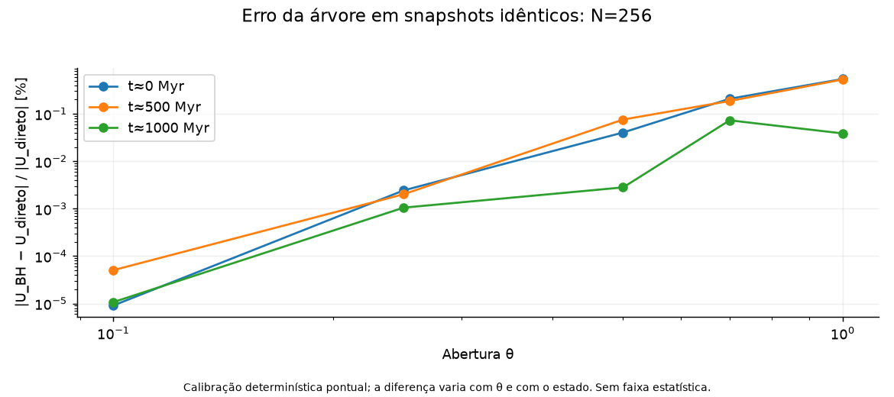

# Comparação entre energia direta e Barnes–Hut

## Resultado identificável na execução original

Oito registros BH, N=80.000, GPU direta Float32, θ=0,5: máximo |δE| **0.01847195%**, último **0.00532793%** em 1124.600 Myr. A variação de 1,6% não consta do histórico exportado.

No estado inicial real regenerado: K=1.8716261528111353, U_direto=-3.7317652584292538, U_BH=-3.7313387965331022, E_direto=-1.8601391056181185. δU=U_BH−U_direto=0.000426461896152; ε_U=0.000114278864457, isto é **0.01142789% de |U|**. O deslocamento equivale a 0.02292634% de |E_direto(0)|. Custo direto medido: 34.204 s, um processo CPU, 3.199.960.000 pares. Esse custo motiva referências selecionadas e paralelas.

## Repetição controlada que reproduziu os oito registros originais

Uma única repetição, com o mesmo N=80.000, semente 2026, halo vivo, dt=0,1 Myr, ε=0,1 kpc, shader direto Float32 e parâmetros efetivos, integrou até 1124,6 Myr. K e U calculados pelo diagnóstico antigo foram **exatamente iguais aos oito valores exportados anteriormente**, incluindo todas as épocas posteriores. Isso fornece evidência forte de reprodução local da trajetória; os estados originais encerrados não existem para uma comparação bit a bit das partículas.

Nos mesmos estados da repetição, foram calculados BH e pares diretos Float64 compensados, em 4 Workers. Os oito snapshots completos foram preservados em `replay-80000-snapshots.json`, com hashes de posições, velocidades, massas e componentes em `replay-80000.csv`. A referência inicial paralela concorda com a avaliação serial anterior. O integrador, o shader, as massas e os passos não foram alterados.

|Tempo [Myr]|Desvio BH histórico [%]|Desvio BH com parâmetros efetivos [%]|Desvio direto [%]|Erro relativo de U_BH [%]|
|---|---:|---:|---:|---:|
|0.0|+0.000000000|+0.000000000|+0.000000000|0.0114279|
|131.9|-0.002062442|-0.002062505|-0.000033682|0.0102531|
|278.8|-0.000063937|-0.000064020|-0.000026375|0.0111731|
|421.3|+0.004982553|+0.004982429|-0.000060128|0.0135156|
|563.5|+0.011897555|+0.011897433|-0.000092532|0.0168810|
|722.0|+0.008842766|+0.008842629|-0.000063988|0.0153326|
|1007.7|+0.018471947|+0.018471775|-0.000136555|0.0198372|
|1124.6|+0.005327934|+0.005327760|-0.000114628|0.0135443|

O maior desvio direto amostrado foi **0.000136555%** (fração 1.36555459e-06); o último foi **-0.000114628%**. Energia inicial direta: -1.8601391056181185; final: -1.8601412378665421, nas unidades internas. A variação medida é pequena e não nula. O maior erro angular amostrado, normalizado por Σ|m r×v| inicial, foi 2.29766e-07.

No máximo aparente em 1007.7 Myr, a curva histórica era **+0.018471947%**; a referência direta deu **-0.000136555%**. Com G e ε² corrigidos, a linha BH dá +0.018471775%; a diferença entre essa linha e o ponto direto é 0.018608330 ponto percentual. A contribuição dominante da variação aparente nessa época é o diagnóstico por árvore. O residual direto tem sinal oposto. Não se expressa essa oposição como uma porcentagem causal artificial limitada a 100%.

Defina b(t)=U_BH(t)−U_direto(t). Na mesma escala |E_direto(0)|, a decomposição é exata: ΔE_BH/|E_direto(0)| = ΔE_direto/|E_direto(0)| + [b(t)−b(0)]/|E_direto(0)|. No pico, os termos percentuais são -0.000136555% + +0.018604095% = +0.018467540%. A curva BH exibida usa seu próprio |E_BH(0)|, o que explica a pequena diferença de denominador. Nenhum desses termos é removido ou ajustado na interface.

O erro de U_BH com θ=0,5 variou de 0.0102531% a 0.0198372%. A varredura θ=0,25; 0,5; 0,75; 1 foi repetida no tamanho real, nos estados inicial e final, sem reintegrar órbitas: `replay-80000-theta.csv`. Custo médio direto assíncrono: 3.486 s/estado; máximo 3.597 s. A repetição completa, com diagnósticos e esperas, durou 365.0 s. Custos refletem esta execução e carga do computador, não benchmarks isolados comparáveis ao ensaio serial em Node.

Os oito pontos não limitam excursões entre épocas nem separam o residual entre erro de truncamento KDK e arredondamento GPU. Isso exige outros controles. Os ensaios pequenos de dt e precisão permanecem separados. A repetição não valida estabilidade estrutural e não sustenta conservação exata durante todos os passos de bilhões de anos.

SVG e dados: `reports/energy-audit/figures/replay-80000-energy.svg`, `replay-80000.csv`, `replay-80000-theta.csv` e `replay-80000-analysis.json`.

## Comparação em snapshots idênticos

`theta-snapshots.csv`: trajetórias diretas legacy N=96 e N=256, estados de 0, 500 e 1000 Myr; em cada estado θ=1, 0,7, 0,5, 0,25, 0,1 e 0. A força da trajetória não muda durante essa varredura diagnóstica. `trajectories.csv` preserva energia direta e BH, com os mesmos estados e a mesma época inicial, ao longo das trajetórias. O erro da árvore varia com a configuração e θ, sem monotonicidade temporal universal. θ=0 é um controle sem aceitação de monopolos distantes, sujeito à ordem da soma Float64.

|Ensaio CPU|N|dt [Myr]|Máx. direto [%]|Último direto [%]|Máx. BH [%]|Máx. erro de U [%]|
|---|---:|---:|---:|---:|---:|---:|
|circular-direct-dt0.1|2|0.1|0.269824|0.177136|0.269824|0|
|circular-direct-dt0.05|2|0.05|0.0188734|0.0136576|0.0188734|0|
|circular-direct-dt0.025|2|0.025|0.00121622|0.000919139|0.00121622|0|
|eccentric-direct-dt0.1|2|0.1|476.34|445.868|476.34|0|
|eccentric-direct-dt0.05|2|0.05|132.024|113.75|132.024|0|
|eccentric-direct-dt0.025|2|0.025|12.5166|0.201657|12.5166|0|
|legacy96-direct-dt0.1|96|0.1|3.64344|3.63312|3.76202|0.209935|
|legacy96-direct-dt0.05|96|0.05|0.300102|-0.187047|0.383105|0.213878|
|legacy96-direct-dt0.025|96|0.025|0.0939405|-0.0449705|0.40036|0.181782|
|legacy256-direct-dt0.05|256|0.05|0.126374|0.0298664|0.277317|0.114413|
|legacy96-forceBH-theta0.5|96|0.05|0.322521|0.0904013|0.439894|0.116398|
|legacy96-forceBH-theta0.25|96|0.05|0.626504|0.101547|0.626916|0.00830176|

Os controles de força BH são identificados no nome do ensaio; sua energia direta diagnostica a trajetória da força aproximada. Aumentar precisão do diagnóstico não torna a força BH simétrica nem garante uma Hamiltoniana global da árvore. Nos demais ensaios a força é direta. Para legacy a cadência é 5 Myr; para as binárias compactas de estresse, cada passo. Os ensaios compactos r=0,1 kpc não resolvem adequadamente encontros em dt grosseiro; resultados muito grandes são preservados e classificados como falhas de resolução, não escondidos.

## Convenção nominal e efetiva da GPU

O limite analítico preservado de 1.0.5 é aplicável à convenção de parâmetros de qualquer soma Plummer positiva, sem importar a dinâmica AGAMA. Para G e ε² desta GPU, a razão |U_efetivo|/|U_nominal| fica entre 1,0000000195877132 e 1,0000000307635846, em aritmética ideal. Trata-se de cerca de 2–3×10⁻⁸ relativamente a U: é uma inconsistência real a corrigir, mas sua escala não explica 1,6%. Esse limite não calibra BH, inverseSqrt ou acumulação GPU.

Os SVG estão junto aos PNG; dados, unidades e hashes constam de `figures/manifest.json`. Não há faixa de incerteza não fundamentada.
