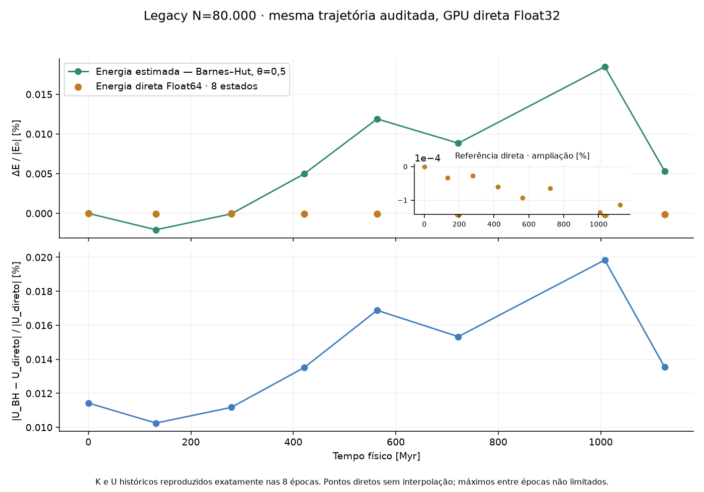

# Validação da conservação de energia

## O que foi demonstrado

O integrador KDK original permaneceu intacto. r e v são síncronos no passo completo. A Hamiltoniana direta Plummer é compatível com a força ideal de pares. Energia direta do estado GPU é calculada em CPU Float64, com os valores efetivamente armazenados de G, ε², massas, posições e velocidades. Isso não converte a trajetória em Float64 nem elimina arredondamento da força.

Os ensaios foram executados com os três passos solicitados (0,1; 0,05; 0,025 Myr), até 1000 Myr, em sistemas controlados. G físico é 0,04498502151469553 nas unidades internas. A realização de 80.000 corpos foi repetida uma vez, reproduzindo exatamente os oito K e U originais e acrescentando referência direta nos mesmos estados da repetição. Seu histórico original permanece preservado. Não se executou uma nova campanha galáctica extensa.

## Repetição controlada que reproduziu os oito registros originais

Uma única repetição, com o mesmo N=80.000, semente 2026, halo vivo, dt=0,1 Myr, ε=0,1 kpc, shader direto Float32 e parâmetros efetivos, integrou até 1124,6 Myr. K e U calculados pelo diagnóstico antigo foram **exatamente iguais aos oito valores exportados anteriormente**, incluindo todas as épocas posteriores. Isso fornece evidência forte de reprodução local da trajetória; os estados originais encerrados não existem para uma comparação bit a bit das partículas.

Nos mesmos estados da repetição, foram calculados BH e pares diretos Float64 compensados, em 4 Workers. Os oito snapshots completos foram preservados em `replay-80000-snapshots.json`, com hashes de posições, velocidades, massas e componentes em `replay-80000.csv`. A referência inicial paralela concorda com a avaliação serial anterior. O integrador, o shader, as massas e os passos não foram alterados.

|Tempo [Myr]|Desvio BH histórico [%]|Desvio BH com parâmetros efetivos [%]|Desvio direto [%]|Erro relativo de U_BH [%]|
|---|---:|---:|---:|---:|
|0.0|+0.000000000|+0.000000000|+0.000000000|0.0114279|
|131.9|-0.002062442|-0.002062505|-0.000033682|0.0102531|
|278.8|-0.000063937|-0.000064020|-0.000026375|0.0111731|
|421.3|+0.004982553|+0.004982429|-0.000060128|0.0135156|
|563.5|+0.011897555|+0.011897433|-0.000092532|0.0168810|
|722.0|+0.008842766|+0.008842629|-0.000063988|0.0153326|
|1007.7|+0.018471947|+0.018471775|-0.000136555|0.0198372|
|1124.6|+0.005327934|+0.005327760|-0.000114628|0.0135443|

O maior desvio direto amostrado foi **0.000136555%** (fração 1.36555459e-06); o último foi **-0.000114628%**. Energia inicial direta: -1.8601391056181185; final: -1.8601412378665421, nas unidades internas. A variação medida é pequena e não nula. O maior erro angular amostrado, normalizado por Σ|m r×v| inicial, foi 2.29766e-07.

No máximo aparente em 1007.7 Myr, a curva histórica era **+0.018471947%**; a referência direta deu **-0.000136555%**. Com G e ε² corrigidos, a linha BH dá +0.018471775%; a diferença entre essa linha e o ponto direto é 0.018608330 ponto percentual. A contribuição dominante da variação aparente nessa época é o diagnóstico por árvore. O residual direto tem sinal oposto. Não se expressa essa oposição como uma porcentagem causal artificial limitada a 100%.

Defina b(t)=U_BH(t)−U_direto(t). Na mesma escala |E_direto(0)|, a decomposição é exata: ΔE_BH/|E_direto(0)| = ΔE_direto/|E_direto(0)| + [b(t)−b(0)]/|E_direto(0)|. No pico, os termos percentuais são -0.000136555% + +0.018604095% = +0.018467540%. A curva BH exibida usa seu próprio |E_BH(0)|, o que explica a pequena diferença de denominador. Nenhum desses termos é removido ou ajustado na interface.

O erro de U_BH com θ=0,5 variou de 0.0102531% a 0.0198372%. A varredura θ=0,25; 0,5; 0,75; 1 foi repetida no tamanho real, nos estados inicial e final, sem reintegrar órbitas: `replay-80000-theta.csv`. Custo médio direto assíncrono: 3.486 s/estado; máximo 3.597 s. A repetição completa, com diagnósticos e esperas, durou 365.0 s. Custos refletem esta execução e carga do computador, não benchmarks isolados comparáveis ao ensaio serial em Node.

Os oito pontos não limitam excursões entre épocas nem separam o residual entre erro de truncamento KDK e arredondamento GPU. Isso exige outros controles. Os ensaios pequenos de dt e precisão permanecem separados. A repetição não valida estabilidade estrutural e não sustenta conservação exata durante todos os passos de bilhões de anos.

SVG e dados: `reports/energy-audit/figures/replay-80000-energy.svg`, `replay-80000.csv`, `replay-80000-theta.csv` e `replay-80000-analysis.json`.

## Segunda ordem e amostragem ao longo da trajetória

Binária resolvida: massas individuais de 10¹⁰ M☉, posições iniciais ±1 kpc, ε=0,005 kpc. Circular: velocidade circular Plummer exata inicial. Excêntrica: 0,65 dessa velocidade. Para energia, **cada passo completo** foi avaliado em 1 Gyr. Para trajetória, compara-se com CPU Float64 dt=0,003125 Myr nos mesmos tempos inteiros de 0 a 100 Myr. Referência refinada é numérica, não solução analítica independente. A circular fornece também um invariante e frequência inicial analíticos.

|Órbita|dt [Myr]|Maior erro absoluto em todos os passos [%]|Máxima diferença de posição [kpc]|Máxima variação relativa de L|
|---|---:|---:|---:|---:|
|circular|0.1|3.161256e-07|0.0006374392|1.66e-14|
|circular|0.05|1.976258e-08|0.0001588976|1.24e-14|
|circular|0.025|1.235561e-09|3.925737e-05|3.08e-14|
|eccentric|0.1|0.2479931|0.01041716|1.09e-14|
|eccentric|0.05|0.06214973|0.002600515|1.51e-14|
|eccentric|0.025|0.01554692|0.0006427191|1.79e-14|

Na excêntrica resolvida, o máximo erro energético cai aproximadamente por 4 ao reduzir dt pela metade, e o erro de trajetória também: evidência da ordem 2 no regime examinado. A circular tem erro de energia com cancelamento de ordem superior (aproximadamente dt⁴), enquanto a trajetória mantém ordem 2; não se deve inferir a ordem do integrador apenas pela energia circular. Os controles compactos de estresse r=0,1 kpc mostram falhas reais em passos grandes e não certificam estabilidade; estão integralmente em `experiments.json` e `trajectories.csv`.

No legacy N=96, força direta CPU Float64, máximos diretos amostrados em 1 Gyr: dt=0,1 → 3,64344%; 0,05 → 0,300102%; 0,025 → 0,0939405%. Isso demonstra melhora nessa realização, sem impor uma lei dt² universal em sistema com encontros e evolução estrutural. Há variação real da Hamiltoniana de pares: a árvore não é a única fonte possível do sinal. A amostragem a cada 5 Myr pode perder picos; os máximos são explicitamente amostrados.

## GPU Float32 e CPU Float64

Cada comparação começa no **mesmo estado lido da GPU**, com massas e coordenadas Float32 preservadas. A CPU usa G, ε² e dt efetivos da GPU. O relógio CPU acompanha dt efetivo; o controlador GPU mostra dt solicitado (diferença de 1,49×10⁻⁸ no tempo relativo). Os ensaios têm 101 medições por trajetória, a cada 10 Myr solicitados. A CPU refaz sqrt(ε²) para sua interface de força; o residual de um ulp ao quadrar é explicitado, sem relevância para alegação percentual. Não foram subtraídas tendências nem normalizados estados depois dos passos.

|Modelo|dt [Myr]|Backend|Maior erro direto amostrado [%]|Último desvio direto [%]|Maior variação relativa de L|
|---|---:|---|---:|---:|---:|
|legacy live halo|0.1|GPU Float32|2.75808|-2.72704|1.84e-06|
|legacy live halo|0.1|CPU Float64|0.982738|0.954015|2.86e-15|
|legacy live halo|0.05|GPU Float32|10.973|10.8135|4.42e-06|
|legacy live halo|0.05|CPU Float64|0.146156|-0.00217638|4.13e-15|
|legacy live halo|0.025|GPU Float32|0.318826|0.00160665|8.45e-06|
|legacy live halo|0.025|CPU Float64|0.9303|0.00330437|4.79e-15|
|resolved eccentric binary|0.1|GPU Float32|0.00884912|-0.00366001|9.06e-06|
|resolved eccentric binary|0.1|CPU Float64|0.0077012|-0.00618616|7.25e-15|
|resolved eccentric binary|0.05|GPU Float32|0.00265724|-0.00186665|4.91e-06|
|resolved eccentric binary|0.05|CPU Float64|0.00192532|-0.00128715|1.09e-14|
|resolved eccentric binary|0.025|GPU Float32|0.00386223|0.00161077|5.23e-06|
|resolved eccentric binary|0.025|CPU Float64|0.000481508|-0.000306144|5.05e-14|

Na binária, a CPU amostrada mantém aproximadamente redução por 4; a GPU chega a um regime em que diminuir dt aumenta o máximo amostrado (mais operações Float32). No legacy N=96 a GPU teve erro real grande e não monotônico, chegando a cerca de 10,97% amostrados em dt=0,05. Isso **não é erro da árvore de energia** e não pode ser escondido. Também não é uma previsão do erro de N=80.000: mudam a granularidade, os encontros e a trajetória. A divergência das posições entre CPU e GPU ao longo de 1 Gyr é registrada, sem ser usada como estimativa de incerteza energética. Não há convergência global Float32 certificada para a galáxia viva.

As binárias GPU e CPU foram amostradas a cada 10 Myr; esses máximos não são comparáveis diretamente aos máximos CPU medidos em todos os passos. Picos de periastro podem ocorrer entre as amostras. Toda tabela declara sua cadência, e nenhum valor final isolado é tomado como certificação do integrador.

## Precisão do diagnóstico

O oracle Decimal-80 de `energy-precision.py` usa `Decimal.from_float` sobre os dados binários exatos, sem trocar ε² por uma constante decimal diferente. Para N=96, o erro relativo de U foi 2.0447e-17; de E, 9.9977e-17. É evidência de precisão da avaliação naquele snapshot, não limite formal universal. Os testes preservados de partição, pares com massas diferentes e limites de convenção também passaram. A versão 1.0.5 é reutilizada metodologicamente; seus resultados AGAMA não são tratados como resultados da página legacy.

## Interface e normalização

δE=(E(t)−E₀)/|E₀|; percentual=100δE; absoluto=|δE|. Se |E₀|≤64·EPS·(K₀+|U₀|), usa-se K₀+|U₀|, explicitado no resumo. Se nem essa escala é positiva e finita, o resultado é indisponível. Máximos são amostrados. Cada método compara seu E₀ no mesmo estado físico inicial. A linha BH permanece estimativa; pontos diretos não são unidos. A comparação δU usa exatamente o mesmo snapshot. Quando não há referência, a interface diz que a conservação ainda não foi verificada diretamente. Somente o ponto inicial tampouco certifica conservação temporal.

Clique **Estimar referência direta**, examine as épocas selecionadas e o custo; depois **Calcular referência direta**. A captura pausa o motor até o passo completo e retoma quando apropriado. O custo é projetado por piloto, pode diferir devido a cópias, aquecimento, concorrência e cache. O progresso avança por partição concluída. **Cancelar referência** termina seus Workers e descarta resultados incompletos; não altera a trajetória. Os resultados completos já obtidos permanecem. JSON energético inclui as partículas auditadas; CSV inclui energias, parâmetros e custos; SVG conserva os pontos reais.

## Reprodução

1. `node scripts/test.mjs` — regressão e contratos físicos de energia.
2. `node scripts/energy-experiments.mjs` — CPU legacy e estresse binário; em uma nova pasta ou após preservar o diretório de resultados desta entrega.
3. `node scripts/energy-resolved-controls.mjs` — binárias resolvidas e comparação temporal.
4. Abra `tests/browser-energy-audit.html` no servidor local; execute cada modelo e preserve o JSON visível. GPU/driver podem alterar resultados Float32; não se presume reprodução bit a bit.
5. Python: `scripts/energy-precision.py` e `scripts/energy-analysis.py` (matplotlib para as figuras).
6. `node scripts/interface-106/site.mjs`, `node scripts/interface-106/identity.mjs`, `node scripts/build.mjs` — gerar a interface e o build estático GitHub/Vercel. Nenhuma publicação remota foi feita.

CSV: `trajectories.csv`, `theta-snapshots.csv`, `resolved-controls.csv`, `gpu-controls.csv`, `observed-80000.csv`, `replay-80000.csv` e `replay-80000-theta.csv`. SVG/PNG: oito figuras em `reports/energy-audit/figures`; manifesto com fontes e hashes. `analysis.json` reúne parâmetros, energia inicial/final, máximos, custos e limitações; os registros GPU completos têm dados de cada época.

Para repetir a auditoria N=80.000, abra `tests/browser-energy-replay.html`, inicie uma vez, exporte pelo botão e preserve o arquivo como `reports/energy-audit/replay-80000-snapshots.json` em uma cópia de trabalho. Execute `node scripts/energy-replay-analysis.mjs`, depois Python `scripts/energy-analysis.py` e `scripts/energy-replay-report.py`, nesta ordem. O relatório inicial é complementado pela repetição; os dados desta entrega devem ser preservados antes de qualquer regeneração.

## Uso na banca

É defensável apresentar a Hamiltoniana, a auditoria do KDK, a calibração da árvore nos estados medidos, a convergência em controles resolvidos e os limites de Float32 e da resolução temporal. **É defensável informar o máximo direto amostrado de 0,000136555% nesta repetição de 80.000 corpos até 1,1246 Gyr.** Os 1,6% não constam dos registros originais. Não há limite sobre picos entre os oito pontos, partição quantitativa do residual entre KDK e Float32 nem validação da estabilidade estrutural. Para a execução da apresentação, audite o início e épocas posteriores com o botão direto e preserve o JSON. Os controles explicitam falhas em regimes não resolvidos, permitindo discutir critérios de convergência em vez de ocultar os erros.

Os custos dos seis controles binários resolvidos estão em reports/energy-audit/resolved-controls-cost-audit.json. O comando node scripts/energy-resolved-controls.mjs --cost-audit produz essa auditoria em arquivos novos; as energias e as métricas de trajetória coincidiram exatamente com os controles preservados. A execução final de regressão tem 126 testes aprovados, sem falhas.

