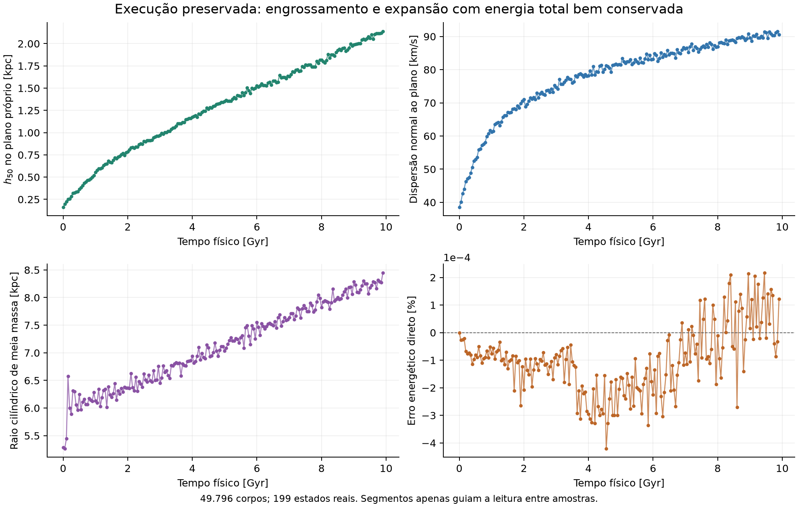
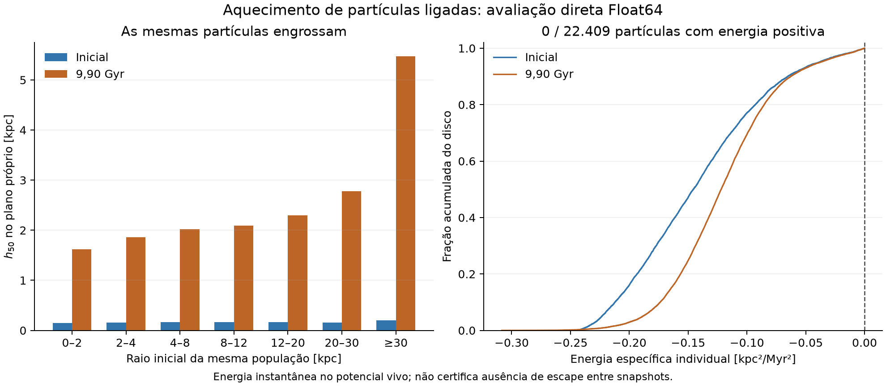

# Diagnóstico do engrossamento do disco na execução preservada

## Conclusão

O crescimento estrutural é real nos dados da realização legacy examinada. Não é defensável apresentar esta realização como um disco da Via Láctea estruturalmente estável por aproximadamente 10 Gyr. O engrossamento não foi explicado por partículas do disco com energia individual positiva: nenhuma das 22.409 partículas do disco tem energia instantânea positiva nos três estados completos disponíveis para esta auditoria (0; 9.850,000000018303; 9.900,000000018485 Myr).

O diagnóstico é aquecimento cinemático e redistribuição de partículas ainda ligadas nesses estados. A conservação da energia total é boa, mas não demonstra equilíbrio estrutural. Não foi feita correção cosmética, remoção de partículas, reescala de velocidades, alteração de massas, modificação do integrador ou substituição das condições iniciais.

## Origem e integridade

- Dados exportados da sessão efetivamente aberta em `experimento-ncorpos.html`, por seus controles existentes. A imagem apresentada pelo usuário estava em aproximadamente 9.400 Myr; a exportação disponível preservava a execução encerrada até 9.900 Myr.
- Realização: `36a246aa-fa41-4425-a763-ef11e9848c07`.
- Arquivo original intacto: `observed-session.json`; SHA-256 `66e48233e209ce09af83c841c0dd1a75d3c3f9701635f1a2c45785f9d326d754`.
- Identidade de código registrada pela sessão: `69dcff9a57a26743bebd3d1f0c2bd7038c2d3b2ff10a76d896ba03c601f81075`.
- 199 estados de diagnósticos e referências energéticas diretas entre o início e 9.900 Myr. Somente três estados retêm posições, velocidades e massas completas no arquivo. Os demais não foram reconstruídos ou inventados.
- 49.796 corpos: 7.469 do bojo; 22.409 do disco; 19.918 do halo. Os IDs, componentes e massas são iguais nos três snapshots completos.
- Força efetiva: **GPU direta Float32**. A árvore Barnes–Hut é usada na estimativa rápida da energia; o rótulo solicitado `algorithm: barnes-hut` no objeto de opções não substitui a identificação do método efetivamente executado (`GPU direct f32`). O erro da estimativa BH não impulsiona as partículas nesta execução.
- Inicialização efetiva: `legacy`, Jeans + Satoh k=1, Gaussianas aproximadas e pares antipodais. Não é a realização AGAMA–Plummer das versões 1.0.4/1.0.5.
- dt = 0,1 Myr; suavização nominal = 0,1 kpc; G efetivo GPU = 0,04498502239584923; ε² efetivo = 0,009999999776482582 kpc²; velocidades sincronizadas após o kick final KDK, segundo os metadados preservados.
- Unidades internas: kpc; Myr; 10¹⁰ M☉. Energias totais em 10¹⁰ M☉ kpc²/Myr² e energias específicas em kpc²/Myr².

## Resultado medido

| Diagnóstico | Inicial | 9,85 Gyr | 9,90 Gyr |
|---|---:|---:|---:|
| h50 no plano próprio [kpc] | 0,163542 | 2,117421 | 2,137174 |
| h90 no plano próprio [kpc] | 0,609018 | 6,667365 | 6,640537 |
| Dispersão normal ao plano [km/s] | 38,583 | 91,528 | 90,598 |
| Raio cilíndrico de meia massa [kpc] | 5,283958 | 8,275104 | 8,446268 |
| Inclinação do plano próprio [graus] | 0,0970 | 10,1499 | 10,1824 |
| Partículas do disco com energia específica positiva | 0 / 22.409 | 0 / 22.409 | 0 / 22.409 |

O h50 aumenta por um fator de aproximadamente 13,07; a dispersão normal por 2,35; o raio cilíndrico de meia massa por 1,60. A energia cinética aleatória normal ao plano aumenta por aproximadamente 5,51 vezes. h50 é uma meia altura ponderada por massa; não é uma altura de escala ajustada nem a espessura total de uma distribuição uniforme.

O crescimento começa cedo: h50 = 0,196354 kpc em 50,00000000000044 Myr; 0,256327 kpc em 200,09999999999292 Myr; 0,553071 kpc em 1.000,0000000001588 Myr; 1,351068 kpc em 5.000,0000000006585 Myr. Apresentar apenas uma janela curta sem declarar essas variações também não certificaria equilíbrio.



## Como foi examinado o escape

Para cada partícula i do disco, foi calculado, em CPU Float64, o potencial completo de todas as outras partículas, sem árvore e com somatório compensado:

φᵢ = −G Σⱼ≠ᵢ mⱼ / √(|rᵢ − rⱼ|² + ε²).

eᵢ = ½ |vᵢ − V_CM|² + φᵢ.

A referência do potencial é zero no infinito e V_CM é a velocidade do centro de massa de todo o sistema. São usadas as massas individuais, o G e o ε² efetivos da GPU. Não há campo externo nesta realização de halo vivo. A conversão dos estados Float32 para Float64 não recupera algarismos que a trajetória Float32 já perdeu; aumenta a precisão do diagnóstico do estado realmente integrado.

O critério eᵢ > 0 identifica energia individual instantânea positiva, não prova escape permanente em um potencial vivo dependente do tempo. Da mesma forma, encontrar eᵢ < 0 nos três estados disponíveis não prova que nunca houve energia positiva entre eles. Não há dados completos para afirmar isso sobre todos os 199 instantes.

As maiores energias específicas encontradas foram −0,00003693793035; −0,00003692625528; −0,00003692627933 kpc²/Myr², respectivamente. Nenhum caso foi positivo. Não foi construído intervalo formal de arredondamento Float64. A espessura recalculada somente com partículas de energia negativa é exatamente a mesma espessura da população completa nos três estados.

Cada auditoria avaliou 22.409 × 49.795 = 1.115.856.155 interações dirigidas entre alvos do disco e fontes. Isso não é a soma global da energia U: o potencial específico de cada alvo deve incluir todas as fontes; para reconstruir U a partir de todos os potenciais individuais, seria necessário o fator 1/2. O tempo medido foi 3,206 s no início (incluindo o controle adicional sem suavização), 2,174 s em 9,85 Gyr e 2,076 s em 9,90 Gyr, usando quatro Workers CPU.

## Não é apenas inclinação, mudança de seleção ou meia dúzia de outliers

O plano próprio inclina aproximadamente 10 graus. Mesmo removendo a inclinação global e medindo planos locais, a região interna engrossa: no estado final, o anel de 4–8 kpc tem h50 local = 1,966 kpc, e o de 8–12 kpc tem h50 local = 2,192 kpc.

Também foram acompanhados os mesmos IDs ao longo dos snapshots, agrupados pelo raio inicial. As 5.466 partículas inicialmente em 4–8 kpc passam de h50 = 0,164922 para 2,016523 kpc; as 2.461 inicialmente em 8–12 kpc passam de 0,161388 para 2,088796 kpc. As populações são fixas: não se trata somente de partículas distintas entrando e saindo de um anel instantâneo.



## Mecanismos sustentados pela auditoria

### 1. Granularidade elevada do halo

| Componente | N | Massa por macropartícula [M☉] |
|---|---:|---:|
| Bojo | 7.469 | 669.434 |
| Disco | 22.409 | 3.034.495 |
| Halo | 19.918 | 49.016.755 |

Cada macropartícula do halo tem 16,153 vezes a massa de uma macropartícula do disco. O halo físico de aproximadamente 9,763 × 10¹¹ M☉ está representado por somente 19.918 fontes móveis. Essas fontes não representam partículas microscópicas individuais de matéria escura.

Esta resolução fornece uma hipótese forte de aquecimento espúrio por granularidade/encontros gravitacionais. A literatura demonstra que esse mecanismo pode engrossar e expandir discos, mesmo com boa conservação de energia global, e depende especialmente da resolução em massa do halo. Isso fundamenta a hipótese, mas não mede a fração causal nesta realização. Ver [Ludlow et al. (2021)](https://arxiv.org/abs/2105.03561) e [Wilkinson et al. (2023)](https://arxiv.org/abs/2208.07623). Os limiares de resolução desses trabalhos não foram adotados como um requisito universal para este modelo.

### 2. As velocidades iniciais e a força integrada não usam o mesmo campo

Em `src/physics/initial-legacy.js`, a pressão vertical e o streaming de Jeans usam `analyticAcceleration`, que representa o campo analítico sem suavização. A integração usa a força de pares Plummer com ε = 0,1 kpc. Gaussianas com momentos de Jeans não estabelecem, por si, uma função de distribuição estacionária do Hamiltoniano de pares.

Foi feito um controle apenas de força nas MESMAS posições iniciais, sem nova integração: calculou-se Wz = Σ m(z − z_CM)a_z usando (a) o Plummer efetivamente integrado, (b) Newton sem suavização entre as mesmas partículas e (c) o campo analítico inicial. O fator 2Kz/(−Wz) é:

| Campo, mesmos estados iniciais | Disco completo | População inicial R < 30 kpc |
|---|---:|---:|
| Pares Plummer efetivos | 1,05322 | 1,05266 |
| Mesmas partículas sem suavização | 1,01079 | 1,01025 |
| Campo analítico sem suavização | 1,00606 | 1,00565 |

O suporte cinemático vertical excede em aproximadamente 5,3% o termo restaurador Plummer medido no instante inicial. O controle demonstra uma diferença de força e um impulso inicial de expansão no momento vertical, não explica quantitativamente o crescimento secular de 13 vezes. Não é teste de equilíbrio completo: termos radiais, evolução da distribuição e momentos de ordem superior continuam relevantes.

### 3. Instabilidades coletivas e relaxação da realização inicial

O Q condicional registrado no início é 0,955 em R = 1,5 kpc; 0,893 em 3 kpc; 1,071 em 6 kpc. A aproximação usa um disco fino e κ analítico inicial; não permite classificar globalmente a estabilidade deste sistema espesso e discreto.

Há evidência de crescimento de assimetria m=2 nos próprios dados. No anel 2–4 kpc, A₂ passa de 0,0141 no início para 0,2305 em 200,1 Myr, diante de um ruído RMS condicional de 0,0227 nesse último estado. Isso é compatível com evolução coletiva importante. Identificar uma barra ou um modo de flexão e medir sua contribuição ao aquecimento exige análise de fase, geometria e trocas de energia/momento angular; o A₂ isolado não basta. Em 9,90 Gyr, A₂ deste anel já caiu para 0,0228.

### 4. A distribuição radial inicial possui caudas muito extensas

O disco Miyamoto–Nagai histórico não foi truncado radialmente. Já no início, 2.174 partículas do disco estão além de 30 kpc, e 304 além de 240 kpc; o maior raio cilíndrico inicial é aproximadamente 63.884 kpc. Essas partículas não foram lançadas a esses raios durante a execução: já pertenciam à amostragem inicial da cauda do modelo.

Essa é uma limitação importante para uma interpretação como disco estelar realista da Via Láctea. Não basta recortar esses pontos na visualização: uma nova distribuição truncada precisaria de densidade/potencial e velocidades consistentes. As caudas também não explicam sozinhas o resultado, pois as populações internas fixas e os planos locais engrossam.

## Energia conservada não invalida esse diagnóstico

O maior |ΔE/|E₀|| direto registrado nos 199 estados é **0,0004202103%**, ou aproximadamente 4,2021 × 10⁻⁶ em fração. O último desvio direto é +0,0001214648%. São diagnósticos Float64 de uma trajetória GPU Float32, sem certificação formal entre amostras.

O maior erro estimado BH é 0,03231586%, e o último é +0,002000453%. A divergência de precisão entre métodos não muda as posições do disco. A força executada era direta, de modo que não se pode atribuir o aquecimento desta execução a uma força Barnes–Hut que não foi utilizada.

Um sistema autogravitante conserva energia total e ainda pode redistribuí-la entre componentes, entre movimento ordenado e aleatório, e entre graus de liberdade. A boa energia total enfraquece a hipótese de que uma grande injeção global de energia pelo integrador seja a explicação principal, mas não isola erros Float32, relaxação por granularidade, instabilidades coletivas ou inadequação das condições iniciais. A causa não está decomposta em porcentagens.

## Próxima validação necessária para buscar um disco duradouro

1. Construir uma realização com função de distribuição/método de equilíbrio compatível com o potencial de TODAS as componentes e com a suavização efetiva. Comparar densidade e momentos; não apenas escalar velocidades globalmente. Candidatos históricos AGAMA devem continuar identificados como candidatos até passarem por essa avaliação no domínio e duração pretendidos.
2. Comparar um halo suave fixo de controle com o halo vivo, preservando as MESMAS partículas bariônicas, massas físicas, dt e ε. O controle fixo não é uma galáxia viva equivalente; serve para isolar a contribuição do halo discreto.
3. Refinar especificamente a resolução em massa do halo e repetir em épocas iguais, com mais de uma semente quando necessário. Aumentar apenas N do disco não resolve a granularidade do halo. Não existe N universal que garanta estabilidade; a convergência deve ser medida.
4. Separar oscilações/migração/morfologia coletiva de aquecimento numérico com h50 local, dispersões, coortes fixas, perfis, modos e transferências entre componentes. Especificar a física e as escalas que se pretende representar, incluindo as caudas do disco.
5. Fazer controle de dt e, quando viável em resolução reduzida controlada, de precisão. Um dt menor não elimina automaticamente relaxação por granularidade. Alterar ε muda a força e exige nova realização/validação; não deve ser usado para esconder o crescimento.
6. Declarar explicitamente o intervalo físico e as variações estruturais efetivamente demonstrados. Não selecionar uma janela ou um limite percentual apenas para poder chamar o modelo de estável.

Esta auditoria reutilizou a execução real e avaliou seus estados. Não iniciou uma nova campanha longa N-corpos nem misturou resultados históricos de outros modelos com ela. Os controles causais acima ainda não foram executados para a realização de 9,9 Gyr analisada.

## Reproduzir e consultar

Arquivos preservados: `observed-session.json` (exportação bruta), `snapshot-manifest.json`, `snapshot-0.bin` a `snapshot-2.bin` (serialização Node/V8), `direct-disk-0.json` a `direct-disk-2.json` (potenciais e forças por ID), `analysis.json`, `summary.csv`, `individual-disk-binding.csv`, `structure-energy-series.csv`, `azimuthal-modes.csv` e figuras em SVG/PNG. Os CSV preservam os tempos completos; arredondamentos neste texto são somente para leitura.

Da raiz do projeto:

```text
node scripts/disk-heating-live/direct-audit.mjs
node scripts/disk-heating-live/analyze.mjs
node --test scripts/disk-heating-live/direct-target-field.test.mjs
python scripts/disk-heating-live/plot.py
node scripts/test.mjs
node scripts/disk-heating-live/verify.mjs
```

O script de figuras requer NumPy e Matplotlib. Ambiente usado: Node 24.19.0; Python 3.14; NumPy 2.5.2; Matplotlib 3.11.1. A medição de custo inclui carga de arquivos, criação dos Workers e cálculos; depende do computador e da carga concorrente. Os arquivos de entrada são imutáveis para o cálculo; a repetição sobrescreve somente os resultados desta auditoria na pasta própria.

Validação: três testes específicos verificam potencial analítico de duas partículas, ausência de autointeração, massas individuais, compatibilidade com a implementação independente de pares e de força do projeto, invariância por translação, imutabilidade e rejeição de singularidades. Os 164 testes existentes do projeto também passaram. A reconstrução de h50 pelos dados brutos coincide com a medição preservada a menos de 10⁻¹⁰ kpc. `verification.json` verifica o SHA-256 da exportação, a igualdade dos parâmetros dos snapshots e os 154 arquivos da identidade preservada do código, todos sem modificação. Também registra hashes dos scripts e resultados desta auditoria. Esses testes validam os cálculos usados na auditoria, não certificam o equilíbrio galáctico. Como o aplicativo não foi modificado, não foi necessário substituí-lo por um novo build para realizar o diagnóstico.
